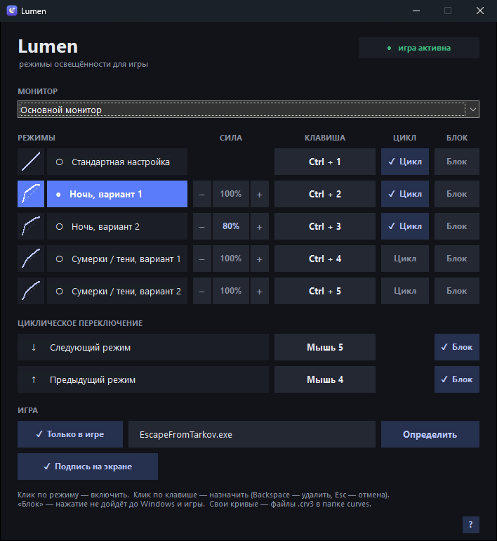
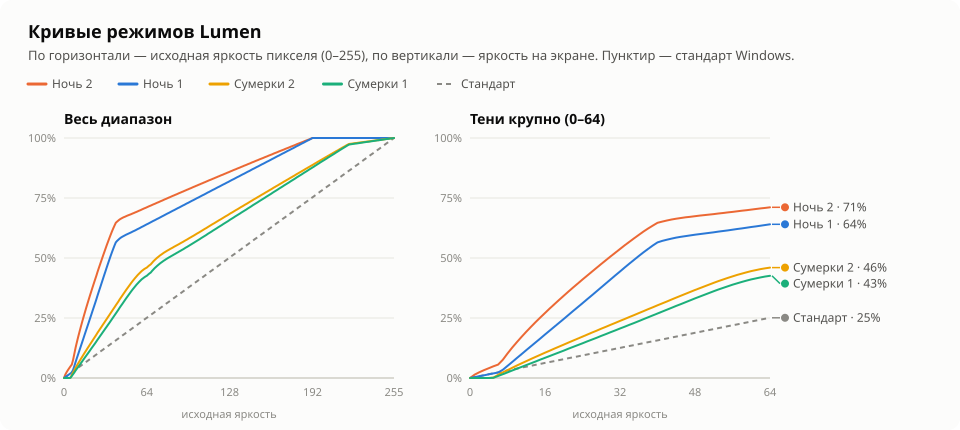

<p align="center">
  
</p>

<h1 align="center">Lumen</h1>

<p align="center">
  Режимы освещённости для игр: одной клавишей вытягивает тени, не засвечивая светлое.<br>
  Меняет гамма-кривую монитора через Windows. В игру не лезет.
</p>

<p align="center">
  
</p>

## Быстрый старт

1. Скачайте [AutoHotkey v2](https://www.autohotkey.com), возьмите из архива `AutoHotkey64.exe`,
   положите в эту папку и переименуйте в **`Lumen.exe`**. Он сам запустит лежащий рядом `Lumen.ahk`.
2. Запустите `Lumen.exe` и согласитесь на права администратора: без них горячие клавиши не сработают,
   если игра запущена от администратора.
3. В игре переключите экран в **оконный без рамки** (Borderless). Нажмите **Ctrl + 2**, чтобы
   включить ночной режим, и **Ctrl + 1**, чтобы вернуть стандарт.

## Режимы

<picture>
  <source media="(prefers-color-scheme: dark)" srcset="docs/curves-dark.svg">
  
</picture>

Насколько ярче становятся тёмные участки. Вход — исходная яркость пикселя от 0 до 255,
в ячейке — яркость на экране и во сколько раз она выше стандартной:

| Режим | вход 8 | вход 16 | вход 32 | вход 64 | вход 128 | Когда включать |
|---|---|---|---|---|---|---|
| Стандарт | 3% | 6% | 13% | 25% | 50% | днём |
| Сумерки 1 | 2% (×0.7) | 8% (×1.3) | 21% (×1.6) | 43% (×1.7) | 66% (×1.3) | вечер, помещения; самые глубокие чёрные чуть темнее, середина светлее |
| Сумерки 2 | 3% (×1.1) | 11% (×1.7) | 24% (×1.9) | 46% (×1.8) | 68% (×1.4) | то же, чуть сильнее |
| Ночь 1 | 5% (×1.6) | 18% (×2.9) | 44% (×3.5) | 64% (×2.6) | 82% (×1.6) | ночь, тёмные подвалы |
| Ночь 2 | 10% (×3.3) | 27% (×4.3) | 54% (×4.3) | 71% (×2.8) | 86% (×1.7) | глубокая ночь без луны |

Если режим слишком сильный, уменьшите его **силу** кнопками − / + (от 10 до 100%):
кривая смешается со стандартной.

## Возможности

- **Горячие клавиши.** Клик по полю «Клавиша», затем нажмите нужную клавишу или сочетание. Подходят
  кнопки мыши 4 / 5 и колесо. Backspace удаляет клавишу, Esc отменяет. Буквы работают в любой раскладке.
- **Цикл ↓ / ↑.** Одна клавиша по очереди перебирает режимы, отмеченные «Цикл».
- **Блок.** Нажатие не доходит до игры: удобно, если клавиша в игре занята.
- **Только в игре.** Вне окна игры автоматически стоит стандарт, при возврате в игру режим
  включается снова. Кнопка «Определить» запоминает окно игры: нажмите её и за 5 секунд переключитесь в игру.
- **Защита от сброса.** Раз в 1,5 с Lumen сверяет кривую на мониторе и ставит её заново, если игра,
  драйвер или Windows её сбросили (смена разрешения, Alt+Tab, выход из сна).
- **Подпись на экране.** При переключении клавишей на секунду видно название режима:

  

- **Монитор.** Основной, любой другой или все сразу.
- **Свои кривые.** См. [ниже](#свои-кривые).

При закрытии Lumen возвращает стандартную кривую.

## Если яркость не меняется

| Причина | Что сделать |
|---|---|
| Игра в эксклюзивном полноэкранном режиме | Включить в настройках игры «Оконный без рамки» (Borderless). |
| Включён HDR в Windows | Гамма-кривые в HDR не действуют: Параметры → Система → Дисплей → выключить HDR. |
| Windows отклоняет сильные кривые («Windows не принял кривую») | Запустить [`tools/enable-gamma-range.reg`](tools/enable-gamma-range.reg) (ставит `GdiIcmGammaRange = 256` в `HKLM\SOFTWARE\Microsoft\Windows NT\CurrentVersion\ICM`) и перезагрузиться. |
| NVIDIA перебивает гамму | Панель управления NVIDIA → Дисплей → «Регулировка параметров цвета рабочего стола» → снять «Приоритет эталонного режима». |
| Кривую сбрасывает другая программа | Закрыть f.lux, утилиты калибровки, «оверлеи» с фильтрами яркости. |
| Клавиши не работают в игре | Запустить Lumen от администратора (по умолчанию так и есть, `RunAsAdmin=1`). |

## Безопасно ли это

Lumen меняет только гамма-таблицу видеокарты стандартной функцией Windows `SetDeviceGammaRamp`, как
программы калибровки монитора. Он не читает и не изменяет память и файлы игры и ничего не рисует
внутри неё. Подпись на экране — отдельное окно Windows поверх игры.
Правила конкретной игры и её античита всё равно решают сами разработчики: гарантий тут дать нельзя.

## Свои кривые

Любой файл `.crv3` в папке `curves` становится режимом (до 11 штук). После добавления файла выберите
в меню значка в трее «Перезапустить».

```
; Моя ночная
0	0	0	0
1	250	250	250
...
255	65535	65535	65535
```

- Кодировка UTF-8. Первая строка `; Название` необязательна и задаёт имя режима (иначе берётся имя файла).
- Нужно ровно 256 строк `индекс R G B`. Индекс от 0 до 255, значения от 0 до 65535.
  Каналы можно задавать разными, тогда получится цветной оттенок.
- Чем выше кривая над диагональю, тем светлее. Слишком крутые кривые Windows может отклонить,
  см. `GdiIcmGammaRange` выше.

Пример: простая гамма-кривая, где `g < 1` осветляет тени:

```python
g = 0.6
lines = ["; Гамма 0.6"] + [f"{i}\t{v}\t{v}\t{v}" for i in range(256)
                           for v in [round((i / 255) ** g * 65535)]]
open("curves/gamma06.crv3", "w", encoding="utf-8").write("\n".join(lines) + "\n")
```

## Настройки (`lumen.ini`)

Создаётся рядом с программой автоматически. Почти всё меняется в окне, но файл можно править и руками.

| Секция / ключ | Значение |
|---|---|
| `Main / RunAsAdmin` | `1` — запрашивать права администратора при запуске |
| `Main / Monitor` | `0` — основной, `1..N` — номер монитора, `-1` — все |
| `Main / LockToGame` | `1` — режим действует только в окне игры |
| `Main / GameWindow` | окно игры, например `ahk_exe EscapeFromTarkov.exe` |
| `Main / OSD` | `1` — показывать подпись при переключении |
| `Keys / <id>` | клавиша в формате AutoHotkey: `^` Ctrl, `!` Alt, `+` Shift; `XButton1/2` — мышь 4/5 |
| `Block / <id>`, `Cycle / <id>` | `1` — включено |
| `Strength / <id>` | сила режима, 10–100 |

`<id>`: `Mode1` — стандарт, `Mode2`–`Mode5` — встроенные кривые, `Curve_<имя файла>` — свои,
`CycleDown` / `CycleUp` — цикл.

## Файлы

| Путь | Что это |
|---|---|
| `Lumen.ahk` | программа (AutoHotkey v2) |
| `curves/*.crv3` | кривые режимов |
| `lumen.ico` | иконка |
| `docs/` | картинки для этого README |
| `tools/curve_chart.py` | перерисовывает графики в `docs/`: `python tools/curve_chart.py` |
| `tools/enable-gamma-range.reg` | снимает ограничение Windows на сильные кривые |

`Lumen.exe` и `lumen.ini` в репозиторий не входят. AutoHotkey распространяется по своей лицензии,
см. `AutoHotkey-license.txt`.
